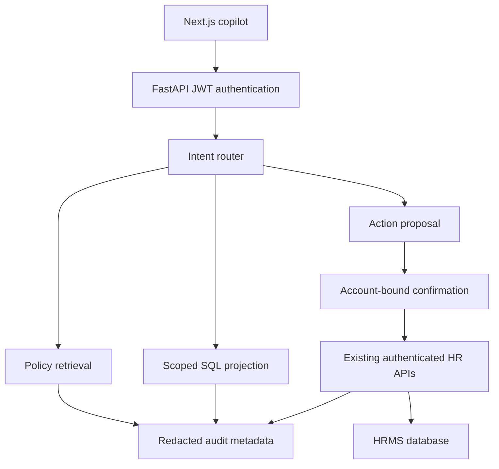

# RekhaCB architecture

The starting point is the supplied Next.js/FastAPI CB Nest repository. Replacing that application with an isolated chatbot would lose its validations, so the implementation keeps its routes and SQLite schema.

## Policy retrieval

Read policies from `hr_policies`, including legacy text and stored PDF/Markdown/text files. Stored paths must resolve inside the configured policy directory. PDFs use text extraction; scanned PDFs need OCR outside this implementation. Chunks are 900 characters with 200-character overlap. A fresh TF-IDF unigram/bigram matrix embeds the chunks; cosine search selects up to three chunks at score 0.10 or above. No match returns an insufficient-evidence response.

Without a provider, the response quotes retrieved excerpts, not an invented paraphrase. With a provider, context is passed as untrusted excerpts and the prompt restricts answers to those excerpts. Obvious embedded instruction lines are removed as an additional defense. Pattern removal and a system prompt are not a proof against every prompt injection; adversarial model testing remains necessary. The policy component has no SQL or action tools.

## SQL boundary

The business database is queried by application-owned SQLAlchemy SELECTs to build a safe in-memory projection: employees, project catalog, scoped assignments and scoped skills. Salary, password, birth date, bank and PAN columns never enter that projection. SQLite metadata and unapproved functions are denied by an authorizer. Single-SELECT checks, a VM instruction budget, and a hard 100-row result limit add separate controls. Connections are closed after each request.

The provider generates SQL against that small schema; local mode uses templates. Authorization is decided before SQL generation. Even a faulty filter cannot recover a hidden employee row because the row is absent from the query database. This trades extra copying for a narrow, inspectable execution boundary. Catalog data is public to authenticated staff; assignment rows are scoped.

Current limitations: local templates do not interpret arbitrary names, compound filters or aggregation requests reliably. Use configured model mode for flexible queries. Leave history, tickets, department names and job history are not yet part of the SQL projection. Own balances are available through the action/API tool.

## Actions and consistency

Action extraction creates a proposal. Only named tools are accepted; URLs, methods and authorization headers are owned by the server. A random proposal ID is stored with owner, expiry and payload. Confirming atomically claims that ID before calling the existing HR API with the original user's bearer token. Body edits from the client do not replace the stored payload. Business writes occur only in the existing endpoints.

Supported tools: own balance, leave submission, ticket creation, leave approval/rejection, announcement creation, project assignment, project creation, ticket assignment and ticket status update. Local extraction covers a subset; the rest require a model. API Pydantic schemas validate the actual payload. Managers cannot decide unrelated employees' leave or staff unrelated employees onto projects. Admin project creation is enforced by the copilot in addition to the existing API rules.

A claimed confirmation is consumed even if the API fails. This prevents blind retries, but a process crash after a successful business write and before the HTTP response creates an ambiguous outcome. Check the HRMS record before creating a new proposal. A transactional outbox and business idempotency keys are future work.

## Authentication and audit

JWT identity is resolved against the database and the database role is authoritative. Refresh tokens cannot authenticate API calls. Audit metadata is separate from business data in SQLite `storage/copilot.db`, created on first use. It records user ID, role, redacted message, route, status, tool, top-level result ID and timestamp. It does not store JWTs, prompts sent to the model, or full HR results. Sensitive requests are replaced with a redaction marker. Redaction is heuristic; production use needs stronger secret detection and retention rules. The recent-audit endpoint only shows the current user's route/status/tool/timestamp.

## Endpoints

All require `Authorization: Bearer <access_token>`:

| Method | Path | Body / purpose |
| --- | --- | --- |
| POST | /api/v1/chat/policy | `{ "message": "What is the leave policy?" }` |
| POST | /api/v1/chat/sql | `{ "message": "Which projects are ongoing?" }` |
| POST | /api/v1/chat/actions | Message; later send returned `confirmation_id` |
| POST | /api/v1/chat/router | Small deterministic intent router |
| GET | /api/v1/chat/audit/recent | Current user's last 20 interactions |

Responses use `{success,data,error}`. Policy data includes answer, sources and mode. SQL includes rows and role-appropriate SQL visibility. Action data includes status, preview/confirmation ID, or an API result. Unexpected internal errors return a generic response without provider or database error details.

## Deployment boundary

Docker Compose is the supported local deployment. SQLite and uploads need persistent disks. Do not deploy this unmodified SQLite/container app as a stateless Vercel function. Keep the API private to the intended audience, replace demo credentials, rotate JWT keys, and introduce production session/cookie handling before using real personnel information.

## Dependency maintenance

The inherited Next.js 15.5.2 dependency was upgraded to 15.5.28, following the official 14 October 2026 maintenance release: https://nextjs.org/blog/nextjs-security-update-october-14-2026 . The lockfile is included. This update does not constitute a full dependency security audit.

## Request Readiness extension

`POST /api/v1/readiness/analyze` accepts a typed leave plan: leave type, start/end date, reason, half-day flag and optional half-day period. It reads only the authenticated user's balances and leave requests. Six checks return pass/warn/block/info states with explanations, alongside policy evidence and a projected balance. Calendar days include weekends. Pending requests are reported as commitments but do not reserve balance in the inherited API. Past dates produce a review warning because the starter allows retrospective submissions.

`POST /api/v1/readiness/prepare` reruns the analysis and refuses hard blockers. Otherwise it creates an account-bound five-minute leave proposal from the validated plan, without using free-text model extraction. The existing confirmation endpoint reruns readiness for these proposals before calling the leave API. Regular chat actions retain their normal API validation path; the readiness gate is specific to plans prepared in this workspace.

The comparison baseline exists only in the browser component's memory. Editing invalidates the displayed current review and proposal. Exported JSON contains the user's plan, check outcomes, policy evidence and snapshot metadata. The fingerprint hashes the plan, actor ID, balance facts, overlap IDs, checks and policy evidence. It is not cryptographically signed and does not prove approval or authenticity. Treat exports and approver briefs as personal HR information.

This recheck does not create a transaction spanning the readiness read and final business write. Another request can race in between those operations; production use needs transactional leave overlap/balance validation and business idempotency keys. There is no automatic approval or employee performance scoring.
